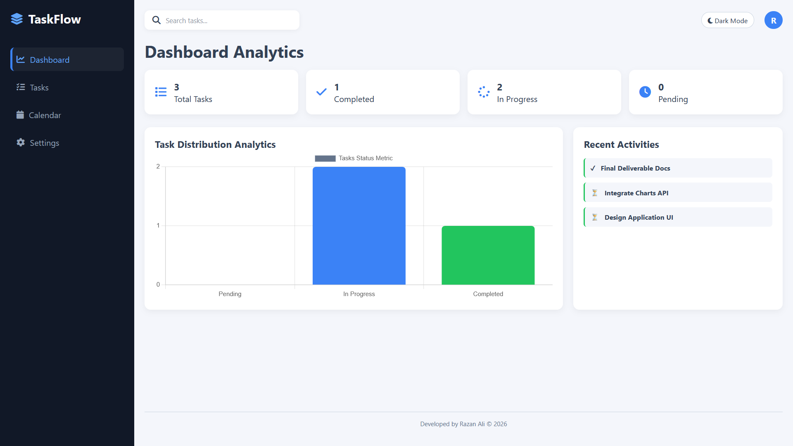
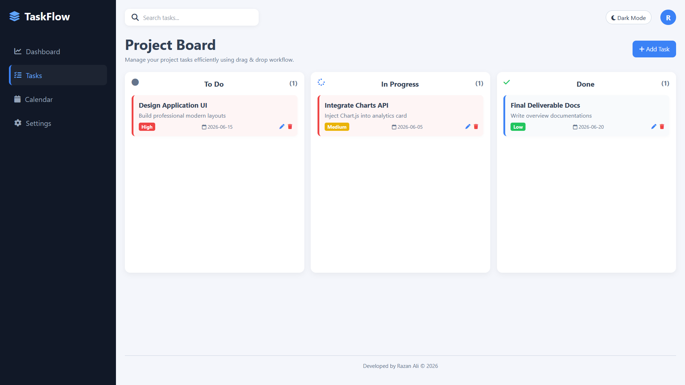
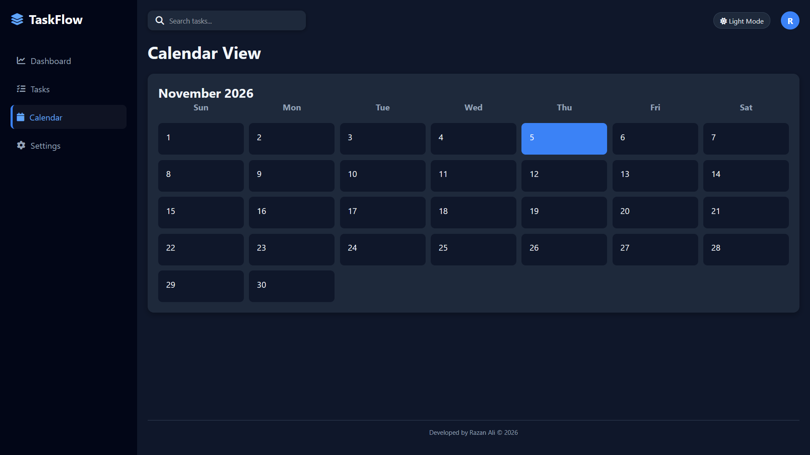

# TaskFlow – Task Management Dashboard

TaskFlow is a responsive task management web application designed to help users organize, track, and manage their daily tasks through a clean and intuitive dashboard.

The application provides a Kanban-style task board, task statistics, and a calendar view to make task management easier and more organized.

## Features

- **Dashboard:** View task statistics, including total, completed, in-progress, and pending tasks.
- **Task Management (CRUD):** Add, edit, and delete tasks.
- **Kanban Board:** Organize tasks into To Do, In Progress, and Done columns.
- **Drag and Drop:** Move tasks between different status columns.
- **Search:** Search tasks by title or description.
- **Calendar View:** View the current month and its days.
- **Dark Mode:** Switch between light and dark themes.
- **Profile Settings:** Update and save your name and email.
- **Local Storage:** Keep tasks and user preferences saved in the browser.
- **Responsive Design:** Adapt the interface to desktop and mobile screens.
- **Data Visualization:** Display task statistics using Chart.js.

## Technologies Used

- HTML5
- CSS3
- JavaScript (Vanilla JavaScript)
- Local Storage
- Chart.js
- Font Awesome

## Project Structure

```text
TaskFlow/
│
├── index.html
├── css/
│   └── style.css
├── js/
│   └── main.js
└── README.md
```

## How to Run the Project

1. Clone the repository:

```bash
git clone YOUR_REPOSITORY_URL
```

2. Open the project folder:

```bash
cd TaskFlow
```

3. Open `index.html` in your browser, or use the VS Code Live Server extension.

## Data Storage

TaskFlow uses the browser's Local Storage to save tasks and profile preferences.

**Note:** This project is a front-end demonstration. It does not include a backend, server-side database, or real user authentication. Data is stored locally in the browser.

## Screenshots

### Dashboard


### Tasks Board


### Calendar


## Future Improvements

- Add a backend and database integration.
- Implement user authentication.
- Enhance calendar functionality.

---

**Developed as a Front-End Development Project.**